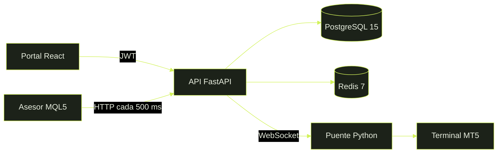

<p align="center">
  
</p>

<h1 align="center">Quant Guardian</h1>

<p align="center">
  <strong>El asesor informa y ejecuta. El servidor decide.</strong><br>
  Vigilancia de drawdown, señales y estrategias para cuentas de MetaTrader 5.
</p>

<p align="center">
  
  
  
  
  
</p>

<p align="center">
  <a href="DOCUMENTACION.md"></a>
  <a href="PENDIENTES.md"></a>
  <a href="http://127.0.0.1:8000/health"></a>
  <a href="http://localhost:5173"></a>
</p>

---

## La decisión

Cada latido de la cuenta vuelve con una acción. El asesor solo obedece esa acción.

<p align="center">
  
  
  
</p>

| Nivel | Cuándo |
|---|---|
| `NORMAL` | Lejos de los límites |
| `ALERT` | Daily o total en el 80 % del tope |
| `KILL` | La acción ya es `FORCE_FLAT` |

El lote se redondea hacia abajo, al paso del bróker. El riesgo configurado no sube por un redondeo.

---

## Qué cubre

<table>
<tr>
<td width="33%" valign="top">

### Riesgo

Drawdown diario, drawdown total y tope de operaciones abiertas. Al cruzar el límite, la cuenta queda plana.

</td>
<td width="33%" valign="top">

### Estrategias

Ruptura de Londres y reversión por Z-score sobre velas cerradas. Pausa en NFP, CPI, FOMC y decisiones de tipos.

</td>
<td width="33%" valign="top">

### Señales

Webhooks externos, por ejemplo TradingView, entran a la cola de la cuenta con deduplicación.

</td>
</tr>
<tr>
<td width="33%" valign="top">

### Copias

De una cuenta propia a otra del mismo usuario. El lote sigue la equidad. Stop y take profit se copian igual.

</td>
<td width="33%" valign="top">

### Portal

Equidad en vivo, semáforo, curva, riesgo, estrategias, historial y vínculos de copia.

</td>
<td width="33%" valign="top">

### Telegram

Aviso al pasar a alerta o a kill-switch. Resumen a las 17:00, hora de Nueva York.

</td>
</tr>
</table>

---

## Cómo se conecta



| Carpeta | Contenido |
|---|---|
| `backend/` | API, modelos, riesgo, estrategias, migraciones y pruebas |
| `frontend/` | Portal en Vite, React y TypeScript |
| `mql5/` | Asesor `QuantGuardian.mq5` y puente `mt5_bridge.py` |

> El asesor y el puente no deben mirar la misma cuenta. Con el socket abierto, la cola ya no sale por HTTP.

---

## Arranque

<table>
<tr>
<td width="50%" valign="top">

### Windows, sin Docker

SQLite y Redis en memoria. La forma más corta de ver el portal.

```powershell
cd backend
copy .env.example .env
pip install -r requirements.txt
$env:DATABASE_URL = "sqlite+aiosqlite:///./dev.db"
$env:REDIS_URL = "memory://"
python -m uvicorn app.main:app --host 127.0.0.1 --port 8000
```

```powershell
cd frontend
npm install
npm run dev
```

</td>
<td width="50%" valign="top">

### Docker

Postgres 15 en `5432`, Redis 7 en `6379`, API en `8000`.

```bash
cp backend/.env.example backend/.env
docker compose up --build
```

El portal se levanta igual, con `npm run dev` dentro de `frontend`.

En un Postgres nuevo, desde `backend`:

```bash
alembic upgrade head
```

El proceso también crea las tablas al arrancar.

</td>
</tr>
</table>

| | |
|---|---|
| API | http://127.0.0.1:8000 |
| Salud | http://127.0.0.1:8000/health |
| Portal | http://localhost:5173 |

Si el portal no está en la misma máquina, cree `frontend/.env` con `VITE_API_URL=http://127.0.0.1:8000`.

| Para | Hace falta |
|---|---|
| API con Postgres y Redis | Docker |
| API en esta máquina | Python 3.12 |
| Portal | Node.js 20 o superior |
| Operar de verdad | MetaTrader 5 en Windows |
| Pruebas | Python 3.12 |

---

## Primera sesión

1. Regístrese en el portal. Eso crea el usuario. La licencia de trading todavía no existe.
2. `POST /api/v1/webhooks/billing` con el evento `subscription.created`, firmado con `WEBHOOK_SECRET`, devuelve `license_key`. Planes: `starter`, `quant_pro`, `institutional`.
3. En **Cuentas**, vincule número y servidor, o deje que el asesor lo haga al iniciar.
4. Pegue la licencia en el asesor o en el puente.

El contrato de `X-Signature` está en [DOCUMENTACION.md](DOCUMENTACION.md). Stripe y Lemon Squeezy todavía no disparan ese evento.

---

## Portal

| Ruta | Para qué |
|---|---|
| `/` | Balance, equidad, drawdown, semáforo y curva |
| `/cuentas` | Licencias, alta de la terminal y chat de Telegram |
| `/riesgo` | Límites, operaciones abiertas, riesgo por trade y filtro de noticias |
| `/estrategias` | Session Breakout y Z-score, por cuenta y símbolo |
| `/operaciones` | Métricas e historial paginado |
| `/copias` | Maestra y seguidoras del mismo usuario |
| `/recuperar` · `/restablecer` | Cambio de contraseña |

Sin `SMTP_HOST`, y con `EXPOSE_RESET_TOKENS=true`, el enlace de restablecimiento se muestra en pantalla. Dura 30 minutos y sirve una sola vez.

---

## MetaTrader 5

<table>
<tr>
<td width="50%" valign="top">

### Asesor

1. Compile `mql5/QuantGuardian.mq5` en MetaEditor.
2. Permita WebRequest hacia `http://127.0.0.1:8000`.
3. Complete `InpApiUrl`, `InpLicenseKey` y, si aplica, `InpInitialBal`.

Latido cada 5 segundos. Consulta cada 500 ms. Magic `770077`. La primera vez manda hasta 300 velas. Luego, las tres últimas de cada barra nueva.

</td>
<td width="50%" valign="top">

### Puente

Socket con la terminal abierta en esta máquina.

```powershell
pip install MetaTrader5 websockets
python mql5/mt5_bridge.py --api http://127.0.0.1:8000 --license CLAVE --account LOGIN
```

`MetaTrader5` solo se instala en Windows. Sin terminal, el puente imprime la orden y no la envía.

</td>
</tr>
</table>

---

## Variables

Copie `backend/.env.example` a `backend/.env`. Ese archivo no se sube.

| Variable | Uso |
|---|---|
| `DATABASE_URL` | Postgres en Docker, o SQLite en local |
| `REDIS_URL` | Redis. `memory://` vale para desarrollo y pruebas |
| `JWT_SECRET` | Firma de la sesión |
| `JWT_EXPIRE_MINUTES` | Duración de la sesión. Por defecto, un día |
| `WEBHOOK_SECRET` | Firma HMAC del cobro y del calendario manual |
| `CORS_ORIGINS` | Orígenes del portal |
| `EXPOSE_RESET_TOKENS` | Muestra el enlace cuando el correo no sale |
| `TELEGRAM_BOT_TOKEN` | Token de BotFather. El chat id se guarda en Cuentas |
| `SMTP_*` y `PUBLIC_APP_URL` | Correo del enlace de restablecimiento |
| `NEWS_FEED_URL` | Calendario. Vacío apaga la descarga |
| `NEWS_REFRESH_HOURS` | Cada cuántas horas se vuelve a pedir. Por defecto, 6 |

Telegram no envía nada si falta el token o el chat id. El aviso sale solo cuando el nivel cambia.

---

## Pruebas

```powershell
cd backend
python -m pytest tests -q
```

Corren contra SQLite y Redis en memoria: riesgo, estrategias, cola, portal, socket, copiadora, Telegram y calendario. No abren MetaTrader 5 ni Postgres.

El portal se compila con `npm run build` dentro de `frontend`.

---

## Todavía fuera

| Tema | Estado |
|---|---|
| Stripe, Lemon Squeezy y USDT | Pendiente |
| WhatsApp | No entra |
| Backtest de EURUSD, US30 y XAUUSD | Pendiente |
| Asesor compilado en una cuenta demo | Depende de su terminal |

<p align="center">
  <a href="DOCUMENTACION.md"><strong>Documentación técnica</strong></a>
  &nbsp;·&nbsp;
  <a href="PENDIENTES.md"><strong>Roadmap</strong></a>
</p>
